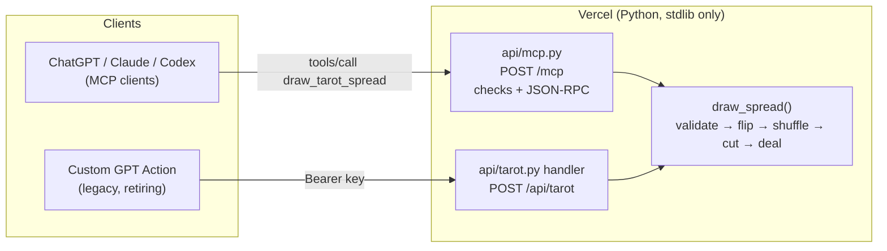

# Tarot Reader

[](https://github.com/StephanRyatt/tarot-reader/actions/workflows/ci.yml)


[](LICENSE)

**An MCP server that gives AI assistants a real, shuffled tarot deck, so the cards in a reading are drawn rather than made up.**

Ask a chat model to "draw three tarot cards" and it picks them itself. The cards come from what the model finds
likely, not from a shuffle, and nothing in the conversation can show otherwise. Tarot Reader gives the model one
tool, `draw_tarot_spread`, that shuffles a full 78-card Rider-Waite deck and deals one card per position. The
tool's instructions tell the model to draw once and to interpret only the cards it was dealt.

---

## Try it

A public instance runs at **`https://tarot-reader-omega.vercel.app/mcp`**. It needs no key and is rate-limited.

* **Claude Code:** `claude mcp add --transport http tarot-reader https://tarot-reader-omega.vercel.app/mcp`
* **claude.ai:** Customize → Connectors → Add custom connector, paste the URL, leave authentication off.
* **ChatGPT:** add it as a custom MCP server with Authentication set to **None** ([steps](docs/clients.md#chatgpt)).

Then ask for a reading, for example "Do a three-card reading about my week."

---

## How it works



* **One engine, two thin interfaces.** `draw_spread()` in [`api/tarot.py`](api/tarot.py) owns every validation
  rule and limit. The MCP handler and the legacy REST endpoint only translate requests into a call to it.
* **The draw mirrors a reader at a table.** A few packets of cards are flipped to create reversals, then the deck
  is shuffled with `random.SystemRandom` (operating-system entropy), cut, and dealt from the top. About 26% of
  cards come out reversed. A test pins that range, and another checks every card is equally likely.
* **Stateless MCP over Streamable HTTP.** Each request stands alone, with no sessions or streams, which suits a
  serverless function. The handler runs a fixed, numbered sequence of checks, including the spec's `Origin` and
  `MCP-Protocol-Version` rules, before routing JSON-RPC.
* **The tool's wording is part of the product.** The server instructions, tool description and the plugin skill
  ([`SKILL.md`](plugin/skills/tarot-reading/SKILL.md)) all tell the model never to invent cards and to draw
  exactly once per reading. [`test_consistency.py`](tests/test_consistency.py) keeps the three in step.

Full request and response details are in [docs/API.md](docs/API.md).

---

## Design decisions

| Decision | Why | Record |
| :--- | :--- | :--- |
| Stateless, JSON-only Streamable HTTP | One quick tool call needs no sessions or streaming; fits serverless | [0001](docs/decisions/0001-stateless-streamable-http.md) |
| Public `/mcp`, no OAuth | ChatGPT custom servers can't send keys; the data isn't sensitive; a rate limit caps abuse | [0002](docs/decisions/0002-public-mcp-without-oauth.md) |
| Standard library only at runtime | No dependency supply chain, fast cold starts, nothing to patch | [0003](docs/decisions/0003-stdlib-only-runtime.md) |
| Tool metadata treated as product, tested | The model's behaviour depends on wording held in three places | [0004](docs/decisions/0004-tool-metadata-is-product.md) |
| Freeze, then retire, the REST/GPT path | Custom GPTs retire on 11 Dec 2026 and Actions don't migrate | [0005](docs/decisions/0005-sunset-rest-endpoint.md) |

---

## How this was built

This project was built with coding agents, with me in the product-owner and reviewer seat.

* **January 2026:** a single Vercel function behind a Custom GPT Action. It was refactored into a pure, seeded
  engine with unit and HTTP tests, then gated by CI.
* **October 2026:** the MCP server and plugin package were added with Cursor
  ([#1](https://github.com/StephanRyatt/tarot-reader/pull/1)).
* **Before going public:** Claude Code audited the repo against best practice. I settled the open decisions
  (licence, public demo, history, evals, REST sunset), and the work landed as reviewed PRs: spec compliance,
  lint and strict typing, fairness and consistency tests, a live deployment behind a rate limit
  ([#2](https://github.com/StephanRyatt/tarot-reader/pull/2)–[#4](https://github.com/StephanRyatt/tarot-reader/pull/4)).

What made that work:

* **[`CLAUDE.md`](CLAUDE.md) is the agent brief.** It is checked in and covers commands, architecture, the order
  of checks that must not change, and the contracts to keep.
* **Tests pin contracts before agents edit.** Status codes, error bodies and the frozen REST contract are all
  asserted, so a regression fails CI instead of slipping through review.
* **Review still matters.** The audit found a test named "chunked" that never sent a chunked body, so the code it
  claimed to cover had never run under test. Green tests are only as good as what they actually exercise.

---

## Development

```bash
python3.12 -m venv .venv && source .venv/bin/activate
pip install -r requirements-dev.txt
python dev_server.py            # REST on any path, MCP at http://127.0.0.1:8000/mcp
```

CI runs the same checks on every push and pull request:

```bash
ruff check . && ruff format --check .
mypy
pytest --cov=api --cov=dev_server --cov-fail-under=95
```

The suite runs in about a second. It covers the engine (validation, invariants, fairness), the REST contract, every
MCP check over a real socket, the dev-server routing, the plugin package, and consistency between the instructions,
tool, skill and docs.

Running your own copy, curl walkthroughs and MCP Inspector: [docs/self-hosting.md](docs/self-hosting.md).
Client setup for ChatGPT, Claude and Codex: [docs/clients.md](docs/clients.md).

---

## Roadmap

* **Behaviour evals:** scripted conversations that check the model draws exactly once, skips the tool when asked
  what a named card means, and uses only the returned cards.
* **Remove the REST endpoint** after Custom GPTs retire on 11 Dec 2026.

---

## License

[MIT](LICENSE)
