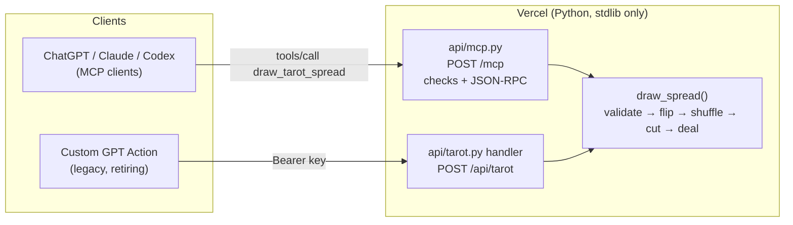

# Tarot Reader

[](https://github.com/StephanRyatt/tarot-reader/actions/workflows/ci.yml)


[](LICENSE)

**An MCP server and plugin that give AI assistants a real, shuffled tarot deck, so a reading can rest on cards that
were actually drawn rather than chosen by the model.**

Ask a chat model with no tools to "draw three tarot cards" and it picks them itself: the cards come from what the
model finds likely, not from a shuffle. Tarot Reader gives the model one tool, `draw_tarot_spread`, that shuffles a
full 78-card Rider-Waite deck and deals one card per position. The tool's instructions and a counseling skill tell
the model to draw once, interpret only the cards it was dealt, and say plainly which way they lean.

A small personal project, built with coding agents. It is a working tool, not a platform.

## Limits

* **Readings are interpretive, for reflection.** They are not advice, and not medical, legal or financial guidance.
  The skill tells the model never to predict events or dates and to leave decisions with the person.
* **The draw is guaranteed; the model's behaviour isn't.** The server deals real cards. Whether a model calls the
  tool, uses only those cards and follows the skill depends on the model. A [behaviour eval](docs/evals.md) checks
  it: the latest full run passed 11 of 11 cases, once each, and a case that missed in an earlier run stated its
  lean in 8 of 10 repeats. That shows it can work, not that it always will.
* **ChatGPT gets the tool, not the skill.** Its custom MCP connection reads only the server's instructions and the
  tool's description. The full counseling skill loads in Claude, through the plugin.
* **The public instance is best effort.** It needs no key, is rate-limited (60 requests a minute per IP), and has no
  uptime guarantee. What it receives and keeps is in the [privacy policy](docs/PRIVACY.md).

---

## Try it

The public instance is at **`https://tarot-reader-omega.vercel.app/mcp`**.

* **Claude (claude.ai, Desktop, Claude Code):** add the plugin, which brings the counseling skill and the spreads:
  Customize → Plugins → Add → Add marketplace → `StephanRyatt/tarot-reader`
  ([steps](docs/clients.md#claude)).
* **ChatGPT:** add it as a custom MCP server with Authentication set to **None** ([steps](docs/clients.md#chatgpt)).

Then ask for a reading, for example "Do a three-card reading about my week."

---

## How it works



* **One engine, two thin interfaces.** `draw_spread()` in [`api/tarot.py`](api/tarot.py) owns every validation
  rule and limit. The MCP handler and the legacy REST endpoint only translate requests into a call to it.
* **The draw mirrors a reader at a table.** A few packets of cards are flipped to create reversals, then the deck
  is shuffled with `random.SystemRandom` (operating-system entropy), cut, and dealt from the top. About 26% of
  cards come out reversed: a test checks the rate stays between 20% and 32% over 7,800 seeded draws, and a chi-square
  test checks that card frequencies are consistent with a uniform draw.
* **Stateless MCP over Streamable HTTP.** Each request stands alone, with no sessions or streams, which suits a
  serverless function. The handler runs a fixed, numbered sequence of checks, including the spec's `Origin` and
  `MCP-Protocol-Version` rules, before routing JSON-RPC.
* **The tool's wording is part of the product.** The server instructions, tool description and the plugin skill
  ([`SKILL.md`](plugin/skills/tarot-reading/SKILL.md)) all tell the model never to invent cards, to draw the spread
  once per reading, and to add a clarifier only with the user's consent.
  [`test_consistency.py`](tests/test_consistency.py) checks that the shared rules and limits appear in all three;
  it checks wording, not behaviour.

Full request and response details are in [docs/API.md](docs/API.md).

---

## Design decisions

| Decision | Why | Record |
| :--- | :--- | :--- |
| Stateless, JSON-only Streamable HTTP | One quick tool call needs no sessions or streaming; fits serverless | [0001](docs/decisions/0001-stateless-streamable-http.md) |
| Public `/mcp`, no OAuth | ChatGPT custom servers can't send keys; the data isn't sensitive; a rate limit caps abuse | [0002](docs/decisions/0002-public-mcp-without-oauth.md) |
| Standard library only at runtime | No third-party packages to audit or patch | [0003](docs/decisions/0003-stdlib-only-runtime.md) |
| Tool metadata treated as product, tested | The model's behaviour depends on wording held in three places | [0004](docs/decisions/0004-tool-metadata-is-product.md) |
| Freeze, then retire, the REST/GPT path | Custom GPTs retire on 11 Dec 2026 and Actions don't migrate | [0005](docs/decisions/0005-sunset-rest-endpoint.md) |
| A counselor that leans, one clarifier on request | Hedged readings gave no decision support; consent keeps extra draws honest | [0006](docs/decisions/0006-counselor-skill.md) |

---

## How this was built

I'm a product manager, not a professional software engineer. This project was built with coding agents: I set
the direction, made the product and design decisions, and reviewed the changes. The longer account, with numbers,
is in [docs/how-its-built.md](docs/how-its-built.md).

* **January 2026:** a single Vercel function behind a Custom GPT Action, refactored into a pure, seeded engine with
  unit and HTTP tests, then gated by CI.
* **October 2026:** the MCP server and plugin package, added with Cursor
  ([#1](https://github.com/StephanRyatt/tarot-reader/pull/1)).
* **Before going public:** Claude Code audited the repo, and the work landed as PRs: spec compliance, lint and strict
  typing, fairness and consistency tests, and a live deployment behind a rate limit
  ([#2](https://github.com/StephanRyatt/tarot-reader/pull/2)–[#4](https://github.com/StephanRyatt/tarot-reader/pull/4)).
  The counseling skill came out of a decision council of independent agents and two rounds of independent review
  ([#7](https://github.com/StephanRyatt/tarot-reader/pull/7)).

What made that work:

* **[`CLAUDE.md`](CLAUDE.md) is the agent brief.** It is checked in and covers commands, architecture, the order
  of checks that must not change, and the contracts to keep.
* **Tests pin contracts before agents edit.** Status codes, error bodies and the frozen REST contract are all
  asserted, so a regression fails CI instead of slipping through review.
* **Review still matters.** The audit found a test named "chunked" that never sent a chunked body, so the code it
  claimed to cover had never run under test. Green tests are only as good as what they actually exercise.

---

## Development

```bash
python3.12 -m venv .venv && source .venv/bin/activate
pip install -r requirements-dev.txt
python dev_server.py            # REST on any path, MCP at http://127.0.0.1:8000/mcp
```

CI runs the same checks on every push and pull request:

```bash
ruff check . && ruff format --check .
mypy
pytest --cov=api --cov=dev_server --cov-fail-under=95
```

The suite runs in about a second. It covers the engine (validation, invariants, fairness), the REST contract, each
MCP check (mostly through the transport-independent core, plus the socket adapter against a local server), the
dev-server routing, the plugin package, and the wording shared by the instructions, tool, skill and docs.

[Behaviour evals](docs/evals.md) play 11 scripted conversations through a real model with the shipped skill and
tool and grade them with code checks, which are themselves tested in CI. A live run needs an Anthropic API key and
costs about $1, so it runs on demand. The latest full run passed 11 of 11 cases
([results](docs/evals.md#results)).

Running your own copy, curl walkthroughs and MCP Inspector: [docs/self-hosting.md](docs/self-hosting.md).
Client setup for ChatGPT, Claude and Codex: [docs/clients.md](docs/clients.md).

---

## Roadmap

* **Remove the REST endpoint** after Custom GPTs retire on 11 Dec 2026.

---

## License

[MIT](LICENSE)
